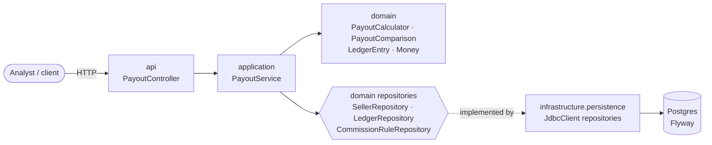

# payout-ops-agent

An AI-assisted payout operations service for marketplaces, built with **Java 25** and
**Spring Boot**. Operations analysts ask questions like *"why did seller 123's payout drop
this week?"* and get an answer grounded in the seller's actual ledger: which components
changed, by how much, and why.

> **Status:** this is being built incrementally, one pull request per milestone (see the
> [roadmap](#roadmap)). The current version contains the payout domain, persistence, a
> reproducible demo scenario and a REST API. The LLM agent, human-in-the-loop actions and the
> MCP server land in the next milestones.

> **Note on the data:** all sellers, orders and amounts in `db/demo` are **synthetic**.

## Why this project exists

Seller support teams in marketplaces spend a lot of time answering one question: *"why is my
payout different this week?"*. The answer is always in the ledger (sales, commissions, refunds,
chargebacks, adjustments), but it takes an analyst several queries to find it.

This project demonstrates how to put an LLM agent on top of that ledger **safely**:

- the model never touches the database directly; it can only call a small set of typed,
  read-only tools backed by a well-tested domain model;
- every number in an answer comes from deterministic code, not from the model;
- any action with side effects (e.g. holding a payout) is only *proposed* by the agent and
  requires explicit human approval.

The domain layer is built first and is deliberately independent of the AI layer, so that it can
be tested exhaustively and reused by the REST API, the agent tools and the MCP server alike.

## What works today

- **Payout domain model** (`domain/`):
  - `Money`, a record that normalizes amounts to the currency's minor units and refuses
    cross-currency arithmetic;
  - `LedgerEntry`, a **sealed interface** with `Sale`, `Commission`, `Refund`, `Chargeback` and
    `Adjustment` records;
  - `PayoutCalculator`, which aggregates entries using **exhaustive pattern matching** over the
    sealed hierarchy (adding a new entry type is a compile error until it is handled);
  - `PayoutComparison`, which explains a change between two periods as per-component
    **drivers** that always add up to the net change.
- **Persistence** with Postgres, Flyway migrations and Spring's `JdbcClient` (plain SQL, no ORM).
- **Reproducible demo scenario** seeded by a repeatable Flyway migration.
- **REST API** with `ProblemDetail` (RFC 9457) error responses.
- **Tests**: fast unit tests for the domain and application layers, plus end-to-end integration
  tests against a real Postgres via **Testcontainers**.
- **CI** on GitHub Actions running the full suite on Java 25.

## Architecture



The layers follow a ports-and-adapters style:

| Package | Responsibility | Depends on |
|---|---|---|
| `domain` | Business rules and repository interfaces. No Spring, no SQL. | — |
| `application` | Use cases (`PayoutService`), orchestrating domain and repositories. | `domain` |
| `infrastructure.persistence` | `JdbcClient` implementations of the domain repositories. | `domain` |
| `api` | REST controllers and response DTOs (the API never exposes domain objects directly). | `application` |

## The demo scenario

The seed (`src/main/resources/db/demo/R__demo_seed.sql`) contains two sellers and two weeks of
ledger entries. Seller **`seller-123` (Aurora Cosmetics)** has a payout drop that is designed to
have several overlapping causes, which is exactly the kind of question the agent will answer:

| | Week of 2026-10-19 | Week of 2026-10-26 | Effect on net |
|---|---:|---:|---:|
| Gross sales | 10,000.00 | 9,800.00 | −200.00 |
| Commissions | 1,000.00 (10%) | 1,470.00 (15%) | −470.00 |
| Refunds | 200.00 | 150.00 | +50.00 |
| Chargebacks | 0.00 | 1,200.00 | −1,200.00 |
| Adjustments | 0.00 | −600.00 | −600.00 |
| **Net payout** | **8,800.00** | **6,380.00** | **−2,420.00 (−27.5%)** |

The commission rate went from 10% to 15% on 2026-10-26 (category reclassification), two orders
from the previous week were charged back, and a logistics fee correction was applied.
`seller-456` (Nimbus Home) is a stable control seller. The integration tests assert these exact
numbers, so the seed and the documentation cannot drift apart silently.

## Running locally

Requirements: **Java 25**, **Maven 3.9+**, and **Docker** (for Postgres and the integration tests).

**Option A: throwaway database via Testcontainers** (nothing else to start):

```bash
mvn spring-boot:test-run
```

**Option B: Docker Compose Postgres:**

```bash
docker compose up -d
mvn spring-boot:run
```

Then try the API:

```bash
# Explain the payout change for the week containing 2026-10-29
curl "localhost:8080/api/sellers/seller-123/payouts/comparison?weekOf=2026-10-29"

# Payout breakdown for one week
curl "localhost:8080/api/sellers/seller-123/payouts?weekOf=2026-10-26"

# Commission rate history
curl "localhost:8080/api/sellers/seller-123/commission-rules"
```

Example response from the comparison endpoint (abridged):

```json
{
  "netChange": { "amount": -2420.00, "currency": "BRL" },
  "netChangePercent": -27.5,
  "drivers": [
    { "component": "CHARGEBACKS", "effectOnNet": { "amount": -1200.00, "currency": "BRL" } },
    { "component": "ADJUSTMENTS", "effectOnNet": { "amount": -600.00, "currency": "BRL" } },
    { "component": "COMMISSIONS", "effectOnNet": { "amount": -470.00, "currency": "BRL" } },
    { "component": "SALES", "effectOnNet": { "amount": -200.00, "currency": "BRL" } },
    { "component": "REFUNDS", "effectOnNet": { "amount": 50.00, "currency": "BRL" } }
  ]
}
```

## API reference

| Method | Path | Description |
|---|---|---|
| `GET` | `/api/sellers/{sellerId}/payouts?weekOf=YYYY-MM-DD` | Payout breakdown for the Monday–Sunday week containing `weekOf`. |
| `GET` | `/api/sellers/{sellerId}/payouts/comparison?weekOf=YYYY-MM-DD` | Compares that week with the previous one: net change, percentage and drivers sorted by impact. |
| `GET` | `/api/sellers/{sellerId}/commission-rules` | Commission rate history, oldest first. |
| `GET` | `/actuator/health` | Health check. |

Unknown sellers return `404` with a `ProblemDetail` body.

## Configuration

| Variable | Default | Description |
|---|---|---|
| `DATABASE_URL` | `jdbc:postgresql://localhost:5432/payoutops` | JDBC URL |
| `DATABASE_USERNAME` | `payoutops` | Database user |
| `DATABASE_PASSWORD` | `payoutops` | Database password |

The demo seed is loaded from `classpath:db/demo` (see `spring.flyway.locations` in
`application.yml`); remove that location for any non-demo deployment.

## Testing

```bash
mvn verify
```

- **Unit tests** (`domain`, `application`): no Spring context, no Docker, run in milliseconds.
  The application layer is tested with in-memory repository implementations instead of mocks.
- **Integration tests** (`PayoutDemoScenarioIntegrationTest`): boot the full application against
  a real Postgres container, run the Flyway migrations and the demo seed, and exercise the
  service and the HTTP API end to end.

## Design decisions

- **Sealed interface + records for the ledger.** The set of entry types is closed and known, so
  the compiler checks every `switch` over it for exhaustiveness: no `default` branch hiding a
  forgotten case.
- **`Money` as a value object.** Amounts are normalized to the currency's minor units on
  construction, so `10` and `10.00` are equal, and mixing currencies fails fast.
- **Drivers that add up.** `PayoutComparison.drivers()` is computed per component as
  `current − previous` of each component's signed effect on the net payout, so the drivers always
  sum to the net change. This is the property the agent will rely on to explain changes without
  doing arithmetic itself.
- **`JdbcClient` instead of JPA.** The ledger is append-only and read through a few explicit
  queries; plain SQL keeps the mapping to the sealed hierarchy obvious and avoids ORM overhead.
- **Repeatable migration for demo data.** Schema changes stay in versioned migrations; the demo
  seed is idempotent (`ON CONFLICT DO NOTHING`) and isolated in its own location.

## Roadmap

- [x] **Domain, persistence and API**: payout model, Postgres + Flyway, demo scenario, REST API, tests, CI
- [ ] **LLM agent**: Spring AI `ChatClient` with read-only `@Tool`s over the payout service;
  `POST /agent/ask` returning the answer plus a trace of the tools it called; profiles for a
  deterministic fake model (tests), OpenAI and Ollama (local, free)
- [ ] **Human-in-the-loop actions**: the agent can propose a payout hold, which stays pending
  until an analyst approves or rejects it via the API
- [ ] **MCP server and observability**: expose the same tools over the Model Context Protocol
  (usable from Claude Desktop and other MCP clients); Micrometer/OpenTelemetry traces for every
  model and tool call, viewable in Jaeger via Docker Compose

## License

[MIT](LICENSE.md)
