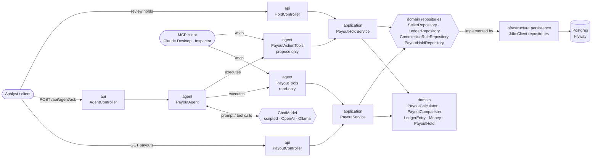
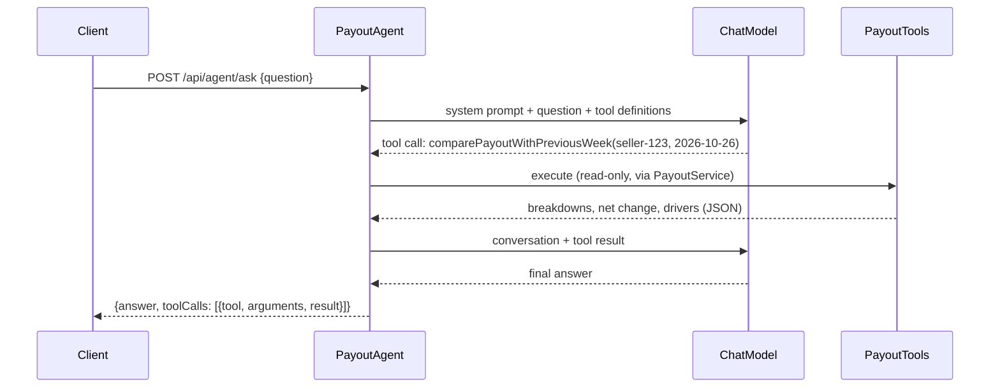
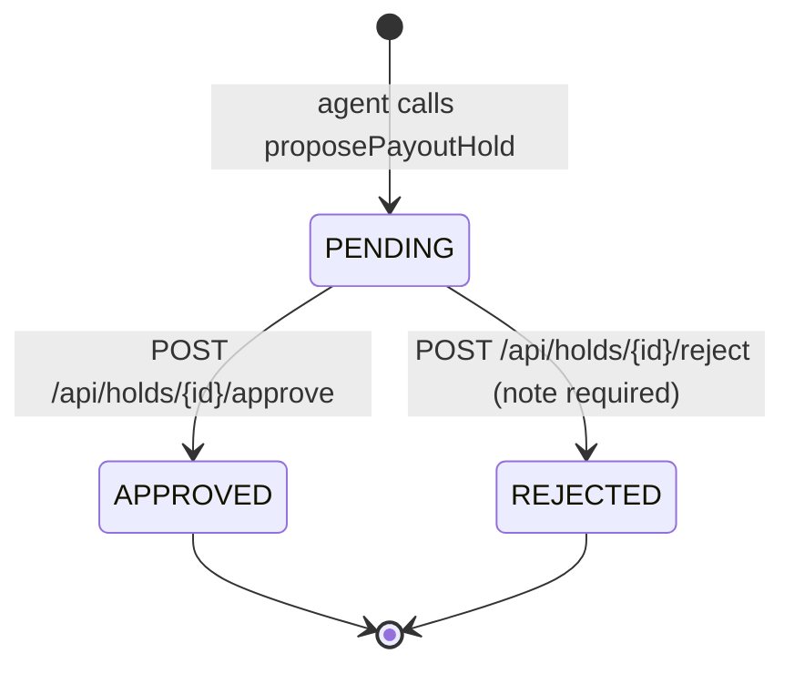

# payout-ops-agent

An AI-assisted payout operations service for marketplaces, built with **Java 25**,
**Spring Boot 4** and **Spring AI 2**. Operations analysts ask questions like *"why did seller 123's payout drop
this week?"* and get an answer grounded in the seller's actual ledger: which components
changed, by how much, and why.

> **Status:** this is being built incrementally, one pull request per milestone (see the
> [roadmap](#roadmap)). The current version contains the payout domain, persistence, a
> reproducible demo scenario, a REST API, the **LLM agent** (Spring AI tool calling, with a
> deterministic offline model, OpenAI and Ollama), **human-in-the-loop payout holds**, an **MCP
> server** exposing the same tools, and **OpenTelemetry tracing** viewable in Jaeger. Everything
> runs locally for free (only the optional `openai` profile is paid).

> **Note on the data:** all sellers, orders and amounts in `db/demo` are **synthetic**.

## Why this project exists

Seller support teams in marketplaces spend a lot of time answering one question: *"why is my
payout different this week?"*. The answer is always in the ledger (sales, commissions, refunds,
chargebacks, adjustments), but it takes an analyst several queries to find it.

This project demonstrates how to put an LLM agent on top of that ledger **safely**:

- the model never touches the database directly; it can only call a small set of typed,
  read-only tools backed by a well-tested domain model;
- every number in an answer comes from deterministic code, not from the model;
- any action with side effects (e.g. holding a payout) is only *proposed* by the agent and
  requires explicit human approval.

The domain layer is built first and is deliberately independent of the AI layer, so that it can
be tested exhaustively and reused by the REST API, the agent tools and the MCP server alike.

## What works today

- **Payout domain model** (`domain/`):
  - `Money`, a record that normalizes amounts to the currency's minor units and refuses
    cross-currency arithmetic;
  - `LedgerEntry`, a **sealed interface** with `Sale`, `Commission`, `Refund`, `Chargeback` and
    `Adjustment` records;
  - `PayoutCalculator`, which aggregates entries using **exhaustive pattern matching** over the
    sealed hierarchy (adding a new entry type is a compile error until it is handled);
  - `PayoutComparison`, which explains a change between two periods as per-component
    **drivers** that always add up to the net change.
- **Persistence** with Postgres, Flyway migrations and Spring's `JdbcClient` (plain SQL, no ORM).
- **Reproducible demo scenario** seeded by a repeatable Flyway migration.
- **REST API** with `ProblemDetail` (RFC 9457) error responses.
- **LLM agent** (`agent/`) built on **Spring AI**:
  - four read-only `@Tool`s over the payout service (comparison, weekly payout, ledger entries,
    commission rules);
  - a tool-calling loop driven by the application, which returns a **trace of every tool call**
    with the answer and stops models that never converge;
  - `POST /api/agent/ask`;
  - a deterministic **scripted model** used by default (no API key needed), plus `openai` and
    `ollama` (local, free) profiles for real LLMs.
- **Human-in-the-loop payout holds**:
  - the agent's only write tool, `proposePayoutHold`, records a `PENDING` proposal and never
    holds anything itself;
  - analysts approve or reject proposals through `/api/holds`, and each hold can be decided
    **exactly once**, even with concurrent reviewers;
  - proposals are idempotent: at most one active (pending or approved) hold per seller and week.
- **MCP server** (Streamable HTTP at `/mcp`): the same five tools, usable from Claude Desktop, MCP
  Inspector or any other MCP client.
- **Tracing** with Micrometer and OpenTelemetry: one span per agent request with every tool call
  (and real model call) nested under it, exported to Jaeger over OTLP.
- **Tests**: fast unit tests for the domain, application and agent layers, plus end-to-end
  integration tests against a real Postgres via **Testcontainers**.
- **CI** on GitHub Actions running the full suite on Java 25.

## Architecture



The layers follow a ports-and-adapters style:

| Package | Responsibility | Depends on |
|---|---|---|
| `domain` | Business rules and repository interfaces. No Spring, no SQL. | — |
| `application` | Use cases (`PayoutService`, `PayoutHoldService`), orchestrating domain and repositories. | `domain` |
| `infrastructure.persistence` | `JdbcClient` implementations of the domain repositories. | `domain` |
| `agent` | LLM orchestration: the tool-calling loop, the read-only tools, the propose-only action tool and the scripted model. | `application`, `api` DTOs |
| `api` | REST controllers and response DTOs (the API never exposes domain objects directly). | `application`, `agent` |

## The demo scenario

The seed (`src/main/resources/db/demo/R__demo_seed.sql`) contains two sellers and two weeks of
ledger entries. Seller **`seller-123` (Aurora Cosmetics)** has a payout drop that is designed to
have several overlapping causes, which is exactly the kind of question the agent will answer:

| | Week of 2026-10-19 | Week of 2026-10-26 | Effect on net |
|---|---:|---:|---:|
| Gross sales | 10,000.00 | 9,800.00 | −200.00 |
| Commissions | 1,000.00 (10%) | 1,470.00 (15%) | −470.00 |
| Refunds | 200.00 | 150.00 | +50.00 |
| Chargebacks | 0.00 | 1,200.00 | −1,200.00 |
| Adjustments | 0.00 | −600.00 | −600.00 |
| **Net payout** | **8,800.00** | **6,380.00** | **−2,420.00 (−27.5%)** |

The commission rate went from 10% to 15% on 2026-10-26 (category reclassification), two orders
from the previous week were charged back, and a logistics fee correction was applied.
`seller-456` (Nimbus Home) is a stable control seller. The integration tests assert these exact
numbers, so the seed and the documentation cannot drift apart silently.

## The agent

`POST /api/agent/ask` takes a question in natural language. `PayoutAgent` sends it to the
configured chat model together with the definitions of four read-only tools. Whenever the model
asks for a tool, the agent executes it, feeds the result back, and repeats until the model
answers:



| Tool | What it returns |
|---|---|
| `comparePayoutWithPreviousWeek(sellerId, weekOf)` | Both weekly breakdowns, net change, percentage and drivers sorted by impact |
| `getWeeklyPayout(sellerId, weekOf)` | One week's breakdown |
| `getLedgerEntries(sellerId, weekOf)` | Individual entries, including chargeback reasons and adjustment descriptions |
| `getCommissionRules(sellerId)` | Commission rate history with the reason for each change |
| `proposePayoutHold(sellerId, weekOf, reason)` | **The only write tool.** Records a `PENDING` hold proposal (or returns the existing one) and reminds the model that nothing was held. See [Human-in-the-loop holds](#human-in-the-loop-holds). |

The model is chosen with a Spring profile:

| Profile | Model | Needs |
|---|---|---|
| _(none)_ | `ScriptedChatModel`: deterministic, follows a fixed script (asks for the comparison tool, or for `proposePayoutHold` when the question says "hold", then templates the answer) | Nothing. Used by the tests and for demos without API keys. |
| `openai` | OpenAI chat model (`gpt-4o-mini` by default) | `OPENAI_API_KEY` |
| `ollama` | Local model through Ollama (`qwen2.5:7b` by default, pulled on first start) | Ollama running locally (`docker compose --profile ollama up -d`) |

Every response carries the full trace of tool calls, so an analyst can check exactly which data
backed the answer:

```bash
curl -X POST localhost:8080/api/agent/ask -H "Content-Type: application/json" \
  -d '{"question": "Why did seller-123'\''s payout drop in the week of 2026-10-26?"}'
```

```json
{
  "answer": "[scripted model] Seller seller-123's net payout changed by BRL -2420.00 (-27.5%) compared with the previous week. Drivers, largest impact first: chargebacks (BRL -1200.00), adjustments (BRL -600.00), commissions (BRL -470.00), sales (BRL -200.00), refunds (BRL 50.00).",
  "toolCalls": [
    {
      "tool": "comparePayoutWithPreviousWeek",
      "arguments": "{\"sellerId\":\"seller-123\",\"weekOf\":\"2026-10-26\"}",
      "result": "{\"previous\":{...},\"current\":{...},\"netChange\":{...},\"drivers\":[...]}"
    }
  ]
}
```

With the `openai` or `ollama` profile, the same question gets a natural-language explanation,
and follow-ups such as *"which orders were charged back?"* make the model call
`getLedgerEntries` as well.

## Human-in-the-loop holds

Holding a seller's payout has real consequences, so the agent can only **propose** it. A human
analyst makes the decision:



- **Propose only.** `proposePayoutHold` lives in its own `PayoutActionTools` class, apart from
  the read-only tools. It returns the proposal plus an explicit note that nothing was held, and the
  system prompt forbids proposing a hold the user didn't ask for.
- **Idempotent proposals.** Asking again for the same seller and week returns the existing hold
  while it is pending or approved (so an approved week is never proposed twice); only a rejected
  hold allows a new proposal. A partial unique index (`WHERE status IN ('PENDING', 'APPROVED')`)
  enforces this in the database, even for concurrent requests. The tool result says whether the
  request `created` a proposal or reused an existing one (whose original reason is kept), so the
  agent never reports a reused hold as a new proposal.
- **Decide exactly once.** A decision is written with `UPDATE … WHERE status = 'PENDING'`. If
  another analyst decided first, the second request gets `409 Conflict` instead of silently
  overwriting the first decision.
- **Audit trail.** Every hold records who proposed it and when, and who decided, when and why.
  Rejections must include a note.

```bash
# The agent proposes (scripted model: any question with "hold", a seller id and a date)
curl -X POST localhost:8080/api/agent/ask -H "Content-Type: application/json" \
  -d '{"question": "Hold seller-123'\''s payout for the week of 2026-10-26, the chargebacks look like fraud"}'

# An analyst reviews and decides
curl localhost:8080/api/holds
curl -X POST localhost:8080/api/holds/<id>/approve -H "Content-Type: application/json" \
  -d '{"analyst": "ana", "note": "Confirmed with the risk team"}'
```

In this demo an approved hold is a recorded decision. In production, approval would trigger the
payout gateway, and the analyst would come from the authenticated user rather than the request
body.

## MCP server

The agent's tools are also published over the [Model Context Protocol](https://modelcontextprotocol.io)
at `http://localhost:8080/mcp` (Streamable HTTP), by Spring AI's MCP server starter. External MCP
clients therefore get **exactly the same** five tools, backed by the same services and guarantees.
This includes `proposePayoutHold`, which can only create a `PENDING` proposal that a human must
approve (see `McpToolsConfiguration`).

**MCP Inspector** (free, needs Node.js):

```bash
npx @modelcontextprotocol/inspector
# then connect to http://localhost:8080/mcp with transport "Streamable HTTP"
```

**Claude Desktop** launches MCP servers as local commands, so it reaches this HTTP server through
the free [`mcp-remote`](https://github.com/geelen/mcp-remote) bridge (needs Node.js). Add this to
`claude_desktop_config.json` (Settings → Developer → Edit Config) and restart Claude Desktop while
the app is running:

```json
{
  "mcpServers": {
    "payout-ops": {
      "command": "npx",
      "args": ["mcp-remote", "http://localhost:8080/mcp"]
    }
  }
}
```

Then ask Claude something like *"Why did seller-123's payout drop in the week of 2026-10-26?"*.
Claude itself becomes the agent, calling `comparePayoutWithPreviousWeek` and friends on your
local app.

> There is no authentication on `/mcp` (nor on the REST API). That's fine for a local demo; add
> auth before exposing either beyond localhost.

## Observability

Every agent request produces a trace:

```
payout agent ask                          payout.agent.ask (chat_model, tool_calls)
├── chat <model>                          gen_ai.client.operation  (OpenAI / Ollama only)
├── execute_tool comparePayoutWithPreviousWeek   spring.ai.tool
├── chat <model>                          gen_ai.client.operation
└── …
```

- `PayoutAgent` opens a `payout.agent.ask` observation per question and passes the
  `ObservationRegistry` to Spring AI's `ToolCallingManager`. The manager defaults to a no-op
  registry, so without that, tool calls would not be traced.
- Model calls are instrumented by Spring AI's OpenAI and Ollama clients. The offline scripted
  model is not, so with it you see the request span and the tool spans.
- Prompts, completions and tool arguments/results are **not** recorded in spans by default
  (`spring.ai.chat.observations.log-prompt`, `log-completion` and
  `spring.ai.tools.observations.include-content` are all `false`), so ledger data doesn't leak
  into the tracing backend.

To see traces in Jaeger (free, runs in Docker):

```bash
docker compose --profile observability up -d     # Jaeger UI on http://localhost:16686
mvn spring-boot:test-run -Dspring-boot.run.profiles=demo,tracing
```

Ask the agent a question, then open Jaeger and search for the `payout-ops-agent` service. Spans
are exported over OTLP/HTTP only when the `tracing` profile is active. Without it no exporter is
created, so tests and normal runs send nothing anywhere.

## Running locally

Requirements: **Java 25**, **Maven 3.9+**, and **Docker** (for Postgres and the integration tests).

**Option A: throwaway database via Testcontainers** (nothing else to start; the `demo` profile
is enabled automatically):

```bash
mvn spring-boot:test-run
```

**Option B: Docker Compose Postgres** (enable the `demo` profile to load the sample data):

```bash
docker compose up -d
mvn spring-boot:run -Dspring-boot.run.profiles=demo
```

**Using a real LLM** (profiles can be combined):

```bash
# OpenAI
OPENAI_API_KEY=sk-... mvn spring-boot:test-run -Dspring-boot.run.profiles=demo,openai

# Ollama, fully local and free (the first start downloads the model, a few GB)
docker compose --profile ollama up -d
mvn spring-boot:test-run -Dspring-boot.run.profiles=demo,ollama
```

Then try the API:

```bash
# Explain the payout change for the week containing 2026-10-29
curl "localhost:8080/api/sellers/seller-123/payouts/comparison?weekOf=2026-10-29"

# Payout breakdown for one week
curl "localhost:8080/api/sellers/seller-123/payouts?weekOf=2026-10-26"

# Commission rate history
curl "localhost:8080/api/sellers/seller-123/commission-rules"
```

Example response from the comparison endpoint (abridged):

```json
{
  "netChange": { "amount": -2420.00, "currency": "BRL" },
  "netChangePercent": -27.5,
  "drivers": [
    { "component": "CHARGEBACKS", "effectOnNet": { "amount": -1200.00, "currency": "BRL" } },
    { "component": "ADJUSTMENTS", "effectOnNet": { "amount": -600.00, "currency": "BRL" } },
    { "component": "COMMISSIONS", "effectOnNet": { "amount": -470.00, "currency": "BRL" } },
    { "component": "SALES", "effectOnNet": { "amount": -200.00, "currency": "BRL" } },
    { "component": "REFUNDS", "effectOnNet": { "amount": 50.00, "currency": "BRL" } }
  ]
}
```

## API reference

| Method | Path | Description |
|---|---|---|
| `GET` | `/api/sellers/{sellerId}/payouts?weekOf=YYYY-MM-DD` | Payout breakdown for the Monday–Sunday week containing `weekOf`. |
| `GET` | `/api/sellers/{sellerId}/payouts/comparison?weekOf=YYYY-MM-DD` | Compares that week with the previous one: net change, percentage and drivers sorted by impact. |
| `GET` | `/api/sellers/{sellerId}/commission-rules` | Commission rate history, oldest first. |
| `POST` | `/api/agent/ask` | Body `{"question": "..."}`. Returns `{answer, toolCalls}`, the answer plus the trace of every tool call. |
| `GET` | `/api/holds?status=PENDING` | Holds with the given status (`PENDING` by default), oldest first. |
| `GET` | `/api/holds/{id}` | One hold, including its decision if any. |
| `POST` | `/api/holds/{id}/approve` | Body `{"analyst": "...", "note": "..."}` (note optional). |
| `POST` | `/api/holds/{id}/reject` | Body `{"analyst": "...", "note": "..."}` (note required). |
| `GET` | `/actuator/health` | Health check. |

Unknown sellers and holds return `404`, invalid input (blank seller id or question, missing
analyst or rejection note) returns `400`, deciding a hold that was already decided returns `409`,
and a model that keeps calling tools without answering returns `502`, all with a `ProblemDetail`
body.
Inside the agent, tool errors such as an unknown seller are not HTTP errors: they are passed back
to the model so it can tell the user.

## Configuration

| Variable | Default | Description |
|---|---|---|
| `DATABASE_URL` | `jdbc:postgresql://localhost:5432/payoutops` | JDBC URL |
| `DATABASE_USERNAME` | `payoutops` | Database user |
| `DATABASE_PASSWORD` | `payoutops` | Database password |
| `OPENAI_API_KEY` | _(none)_ | Required by the `openai` profile |
| `OPENAI_CHAT_MODEL` | `gpt-4o-mini` | OpenAI model (`openai` profile) |
| `OLLAMA_BASE_URL` | `http://localhost:11434` | Ollama server (`ollama` profile) |
| `OLLAMA_CHAT_MODEL` | `qwen2.5:7b` | Ollama model; must support tool calling (`ollama` profile) |
| `OTLP_TRACES_ENDPOINT` | `http://localhost:4318/v1/traces` | OTLP/HTTP traces endpoint (`tracing` profile) |

Spring profiles: `demo` loads the sample data; `openai` / `ollama` select the chat model (without
either, the scripted model is used); `tracing` exports traces over OTLP.

The demo seed is **opt-in**: it is only loaded when the `demo` Spring profile is active (see
`application-demo.yml`). Without it, Flyway only applies the schema, so pointing the service at a
real database never inserts synthetic sellers or ledger entries.

## Testing

```bash
mvn verify
```

- **Unit tests** (`domain`, `application`, `agent`): no Spring context, no Docker, run in
  milliseconds. The application layer is tested with in-memory repository implementations instead
  of mocks. `PayoutAgentTest` runs the real Spring AI tool-calling loop against in-memory data,
  including tool errors, hold proposals and a model that never stops calling tools, and checks
  with a `TestObservationRegistry` that tool spans are nested under the request span.
  `PayoutHoldTest` and `PayoutHoldServiceTest` cover the hold lifecycle, idempotent proposals and
  a decision lost to a concurrent one.
- **Integration tests**: boot the full application against a real Postgres container.
  `PayoutDemoScenarioIntegrationTest`, `AgentEndpointIntegrationTest` and
  `HoldWorkflowIntegrationTest` run with the `demo` profile and exercise the service, the agent,
  the hold workflow and the HTTP API end to end; `McpServerIntegrationTest` starts the app on a
  random port and uses a real MCP client to list and call the tools; `DefaultProfileIntegrationTest`
  checks that no demo data is loaded without that profile.

No test needs an API key or a running LLM: they all use the scripted model.

## Design decisions

- **Sealed interface + records for the ledger.** The set of entry types is closed and known, so
  the compiler checks every `switch` over it for exhaustiveness: no `default` branch hiding a
  forgotten case.
- **`Money` as a value object.** Amounts are normalized to the currency's minor units on
  construction, so `10` and `10.00` are equal, and mixing currencies fails fast.
- **Drivers that add up.** `PayoutComparison.drivers()` is computed per component as
  `current − previous` of each component's signed effect on the net payout, so the drivers always
  sum to the net change. The agent relies on this property to explain changes without doing
  arithmetic itself.
- **`JdbcClient` instead of JPA.** The ledger is append-only and read through a few explicit
  queries; plain SQL keeps the mapping to the sealed hierarchy obvious and avoids ORM overhead.
- **Repeatable migration for demo data.** Schema changes stay in versioned migrations; the demo
  seed lives in its own location, behind the `demo` profile, and replaces the demo sellers' data
  wholesale every time it changes, so the database can never drift from the file.
- **Application-driven tool execution.** In Spring AI 2 a `ChatModel` only returns the tool calls
  the model asks for; `PayoutAgent` executes them with `ToolCallingManager` and owns the loop. That
  makes the tool trace a first-class part of the response and lets the agent cap the number of
  tool rounds, so a misbehaving model fails fast with a `502` instead of looping and burning
  tokens. Calls and results are paired by position, because some providers (e.g. Ollama) may send
  empty tool call ids.
- **The model only reads through tools.** Tools are thin, read-only adapters over
  `PayoutService` and return the same DTOs as the REST API. The system prompt tells the model to
  take every number from the tools; the drivers already add up to the net change, so the model
  never has to do arithmetic.
- **A scripted model instead of mocks.** `ScriptedChatModel` implements Spring AI's `ChatModel`
  and goes through the real tool-calling loop, so the tests (and anyone trying the project
  without an API key) exercise the same code path as OpenAI or Ollama.

## Tech stack

| | |
|---|---|
| Language | Java 25 (records, sealed interfaces, pattern matching) |
| Framework | Spring Boot 4.1 (Spring Framework 7, Jackson 3) |
| AI | Spring AI 2.0: tool calling, OpenAI and Ollama starters, MCP server |
| Persistence | PostgreSQL 17, Flyway, `JdbcClient` |
| Observability | Micrometer Observation, OpenTelemetry (OTLP), Jaeger |
| Testing | JUnit 5, AssertJ, MockMvc, Testcontainers 2, MCP Java SDK client, `TestObservationRegistry` |
| Build & CI | Maven, GitHub Actions, Dependabot |

## Roadmap

- [x] **Domain, persistence and API**: payout model, Postgres + Flyway, demo scenario, REST API, tests, CI
- [x] **LLM agent**: Spring AI tool calling with read-only `@Tool`s over the payout service;
  `POST /api/agent/ask` returning the answer plus a trace of the tools it called; a deterministic
  scripted model (default and tests), OpenAI and Ollama (local, free) profiles
- [x] **Platform upgrade**: Spring Boot 4.1 and Spring AI 2.0 (Jackson 3, Testcontainers 2)
- [x] **Human-in-the-loop actions**: the agent can propose a payout hold, which stays pending
  until an analyst approves or rejects it via the API
- [x] **MCP server and observability**: expose the same tools over the Model Context Protocol
  (usable from Claude Desktop and other MCP clients); Micrometer/OpenTelemetry traces for every
  model and tool call, viewable in Jaeger via Docker Compose

## License

[MIT](LICENSE.md)
